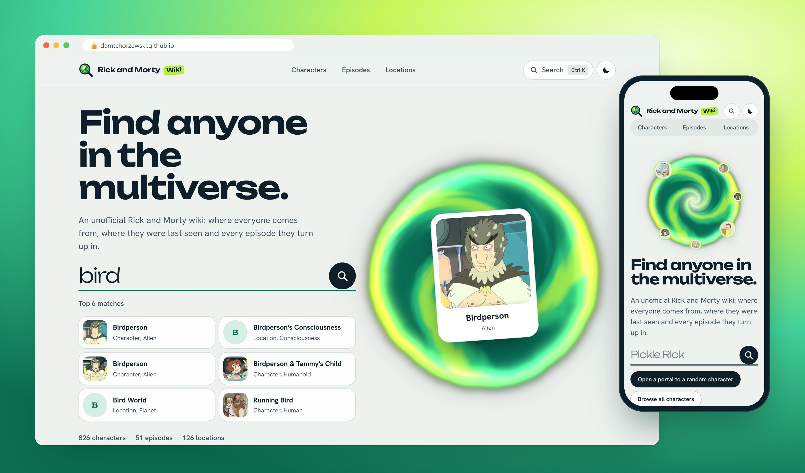
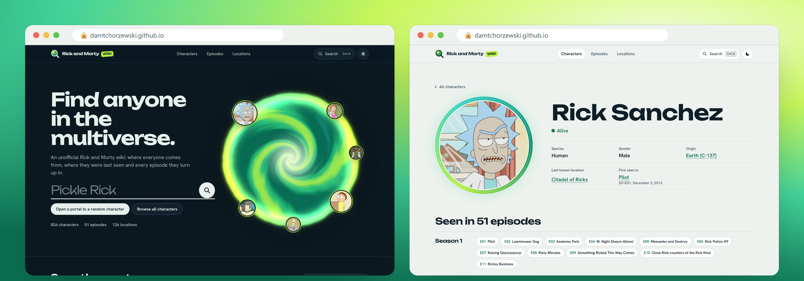
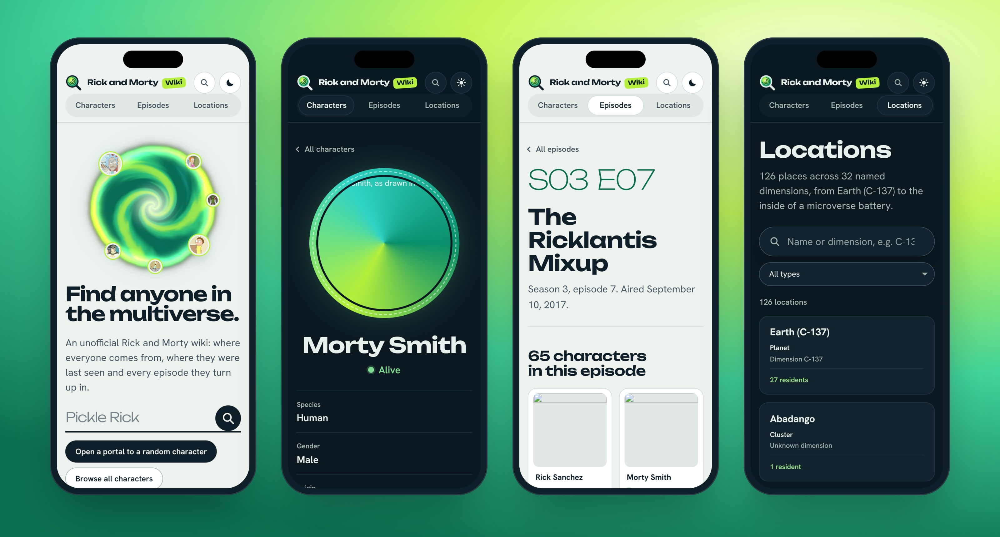

<p align="center">
  <picture>
    <source media="(prefers-color-scheme: dark)" srcset="docs/images/banner-dark.png">
    
  </picture>
</p>

<p align="center">
  
</p>

## About

<a href="https://damtchorzewski.github.io/character-wiki-explorer/"></a>

An **unofficial Rick and Morty wiki**. Every character, episode and location of the public
[Rick and Morty API](https://rickandmortyapi.com/) is a fast static page, and everything is one search away. The
build fetches the API once and writes 1,008 pages; the browser only loads the portraits the API serves.

- **A living portal.** The home page hero is a WebGL shader (no library, a few kilobytes) that swirls, leans towards
  the pointer and has six characters drifting around its rim. Type a name and the best match comes out of the portal
  as a card, with the top six results across characters, episodes and locations under the field.
- **Characters.** Search by name, filter by status, gender and species, sort by name or by the number of episodes,
  page through 24 at a time. The state lives in the URL, so a filtered list can be shared.
- **Character pages.** Portrait, status, species, type, gender, origin and last known location (linked), the first
  episode and every appearance grouped by season, previous and next character.
- **Episodes and locations.** All 51 episodes by season with air dates and cast; 126 locations with a search by name
  or dimension and a filter by type; every resident of a place.
- **Quick search everywhere.** `Ctrl` + `K` (`⌘` + `K` on a Mac) opens a search dialog on any page.
- **Light and dark theme.** Follows the system setting, with a toggle that remembers the choice and no flash.
- **Accessible (WCAG 2.2 AA).** Skip link, landmarks, visible focus, labelled controls, announced result counts,
  24 px minimum targets, reduced-motion support; axe reports no violation on any page template in either theme.
- **Strict CSP.** A Content Security Policy with the hash of every script on each page, fonts self-hosted.

## Tech stack

|         |                                                                                                            |
| ------- | ---------------------------------------------------------------------------------------------------------- |
| Stack   | Astro 7 (static output) with React 19 islands, TypeScript 6, Node 22                                       |
| UI      | plain CSS with design tokens, WebGL fragment shader, Unbounded and Hanken Grotesk (self-hosted)            |
| Data    | the public Rick and Morty API, fetched at build time; JSON indexes for search in the browser               |
| Tests   | Vitest (data mapping, search, filters, paging, formatting), ESLint with accessibility rules, `astro check` |
| Hosting | GitHub Pages, deployed by GitHub Actions                                                                   |

The content, the code and the commits are in English.

## Screenshots

<p align="center">
  
</p>
<p align="center">
  
</p>

## Quick start

```bash
git clone https://github.com/DamTchorzewski/character-wiki-explorer.git
cd character-wiki-explorer
pnpm install
pnpm dev          # http://localhost:4321
```

Requirements: Node.js 22.23 or newer (`.nvmrc`) and pnpm 11 (`packageManager` in `package.json`). The first `dev` or
`build` fetches the API (about 10 requests) and caches the result for a day in `node_modules/.cache`.

## Scripts

| Command          | What it does                                             |
| ---------------- | -------------------------------------------------------- |
| `pnpm dev`       | development server with hot reload                       |
| `pnpm build`     | production build into `dist/` (1,008 pages)              |
| `pnpm preview`   | serves the production build locally                      |
| `pnpm check`     | `format:check`, `lint`, `typecheck` and `test` in one go |
| `pnpm format`    | Prettier, writes the files (`format:check` only reports) |
| `pnpm lint`      | ESLint (`lint:fix` fixes what it can)                    |
| `pnpm typecheck` | `astro check`: types in `.ts`, `.tsx` and `.astro` files |
| `pnpm test`      | Vitest: the data and search logic                        |
| `pnpm health`    | smoke check of the live site; needs `SITE_URL`           |

## Configuration

The site has no secrets and needs no environment to build. One optional variable is listed in
[.env.example](.env.example):

| Variable   | Effect                                                                                                    |
| ---------- | --------------------------------------------------------------------------------------------------------- |
| `SITE_URL` | the public address with its path; sets the base path and the canonical URLs. Empty = a build for the root |

The deploy workflow reads the address from the Pages settings itself; a repository variable `SITE_URL` is needed only
for a custom domain.

## Structure

```
src/
  lib/api.ts              build-time fetch of the whole API, with retries and a one-day cache
  lib/normalize.ts        API shapes to the site's slim data, indexes for the browser
  lib/filter.ts           search, filters, sorting, paging and the URL query, shared by build and browser
  lib/format.ts           dates, numbers and plurals through Intl, links with the base path
  styles/global.css       ★ design tokens for both themes, type scale, shared components
  layouts/Base.astro      head, CSP-friendly theme script, skip link, header and footer
  components/             Portal (hero), HeroSearch, QuickSearch, CharacterExplorer, LocationExplorer, tiles
  scripts/portal.ts       ★ the WebGL portal shader and its pointer and visibility handling
  pages/                  home, characters, episodes, locations (lists and [id] pages), data/*.json, 404
public/favicon.svg        the mark in both colour schemes
tests/                    Vitest tests of src/lib
scripts/health.mjs        smoke check used by the deploy workflow
docs/                     documentation; docs/images/ holds the README images (generated)
.github/workflows/        deploy.yml: check, build, publish to Pages, health check
```

## Branches and workflows

Shared standards from `reops/standards`: `main` ≤ `develop` ≤ a working branch `<type>/<topic>`, two pull requests
(work into `develop`, release into `main`), Conventional Commits in English; see `git.md` and `workflows.md` there.
The one workflow, `deploy.yml`, is level 1 (a static site with a build): a push to `develop` checks and builds, a push
to `main` also publishes to GitHub Pages and runs `pnpm health`.

**Departures from the standards (and why):**

- **`pnpm check` runs inside the build job.** Level 1 has no CI workflow; the checks take about half a minute, so they
  gate the build instead.
- **No Playwright suite in the repository.** Level 1 asks for an axe check by hand; it was run with Playwright and
  `@axe-core/playwright` from another project over every page template in both themes (see
  [docs/frontend.md](docs/frontend.md)).
- **Security headers come from a `<meta>` CSP.** GitHub Pages cannot send headers, so the Content Security Policy is
  written by Astro into every page; the other headers of `security.md` cannot be set there.
- **Images are hotlinked from the API.** The portraits are the API's own files on its CDN (cached for 90 days), not
  copies in this repository, so the site never redistributes the artwork.

## Documentation

| Document                                     | Covers                                                              |
| -------------------------------------------- | ------------------------------------------------------------------- |
| [docs/architecture.md](docs/architecture.md) | how the data flows from the API to static pages and browser indexes |
| [docs/frontend.md](docs/frontend.md)         | design, the portal shader, themes, accessibility and performance    |
| [docs/deployment.md](docs/deployment.md)     | GitHub Pages, the workflow, the health check, rollback              |
| [docs/repository.md](docs/repository.md)     | name, GitHub description, topics and the settings made by hand      |

The README images (`docs/images/`) are regenerated with `tools/readme-images`, profile `character-wiki-explorer`; the
working shots go to `.scratch/`. The documents in `docs/` are in English.

---

<p align="center">
  An unofficial fan project, not affiliated with the show or its owners. Data and portraits:
  <a href="https://rickandmortyapi.com/">The Rick and Morty API</a>.<br>
  Author: <b>Damian Tchorzewski</b>
</p>
